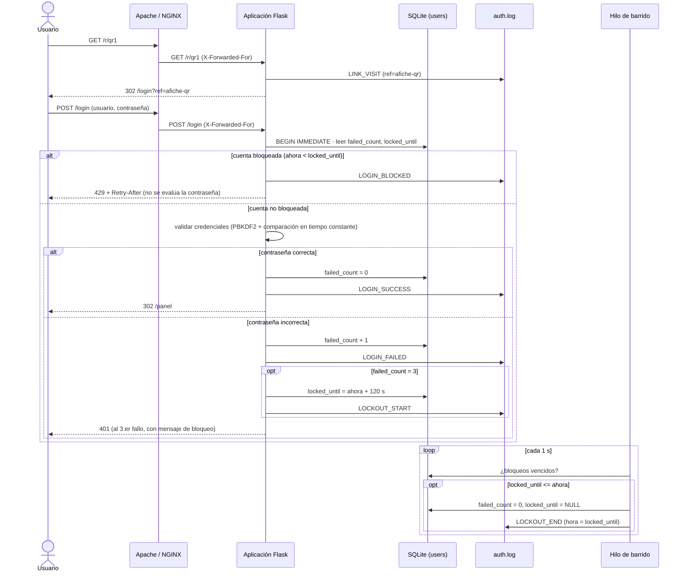

# Diseño de la aplicación

## Diagrama de secuencia (UML, Mermaid)

Modo `hardened` (con controles). En `baseline` no hay bloqueo ni escritura en `auth.log`.
Se puede renderizar en https://mermaid.live o en la vista previa de Markdown de VS Code/GitHub.

## Reglas
- Bloqueo tras 3 fallos **consecutivos**; dura 120 s; la contraseña correcta se rechaza durante el bloqueo.
- Éxito reinicia el contador. El fin del bloqueo se registra como `LOCKOUT_END` con la hora programada de fin.
- El mensaje de error es genérico, pero los usuarios inexistentes nunca se bloquean: una cuenta que responde 429 tras tres fallos existe (enumeración posible).
- Registro JSON Lines con lista cerrada de campos: no existe campo para contraseñas.
- Códigos: 401 fallo, 429 bloqueo, 302 éxito.
