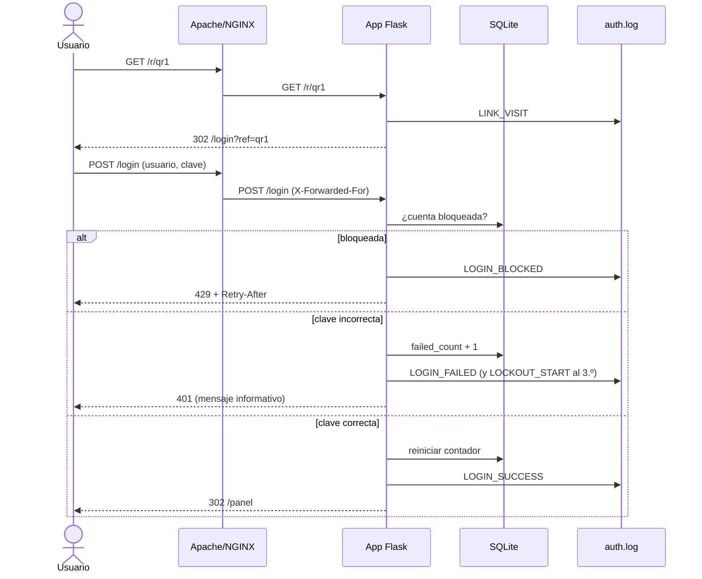

# Diseño de la aplicación

## Diagrama de secuencia (UML, Mermaid)

## Reglas
- Bloqueo tras 3 fallos **consecutivos**; dura 120 s; la contraseña correcta se rechaza durante el bloqueo.
- Éxito reinicia el contador. Fin del bloqueo se registra como `LOCKOUT_END`.
- Respuestas genéricas: no revelan si el usuario existe.
- Registro JSON Lines con lista cerrada de campos: no existe campo para contraseñas.
- Códigos: 401 fallo, 429 bloqueo, 302 éxito.
