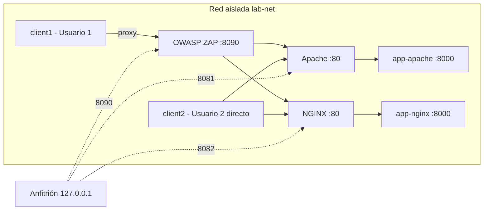

# Laboratorio

## Topología (Docker Compose)

## Modo máquinas virtuales
El PDF habla de máquinas. Si el docente exige VM: 2 equipos de usuario, 1 con Apache, 1 con NGINX y 1 de monitoreo con ZAP en una red interna (host-only). Reutilice `app/`, `servers/apache/httpd.conf` y `servers/nginx/nginx.conf`, cambiando el destino del proxy por la IP de la app. Documente las IP en esta página.

## Pasos de la demo (guion corto)
1. Mostrar el mensaje simulado y el QR.
2. Abrir el enlace desde el usuario 1 (pasa por ZAP) y ver `LINK_VISIT`.
3. Modo `baseline`: 3+ intentos fallidos sin bloqueo.
4. Modo `hardened`: 3 fallos → mensaje de bloqueo; contraseña correcta rechazada; fin del bloqueo y acceso.
5. Mostrar `auth.log`, `access.log` y el historial de ZAP.
6. Comparar matrices inicial y residual.

## Nombres de host
`apache` y `nginx` dentro de la red; `127.0.0.1:8081/8082` desde el anfitrión.
